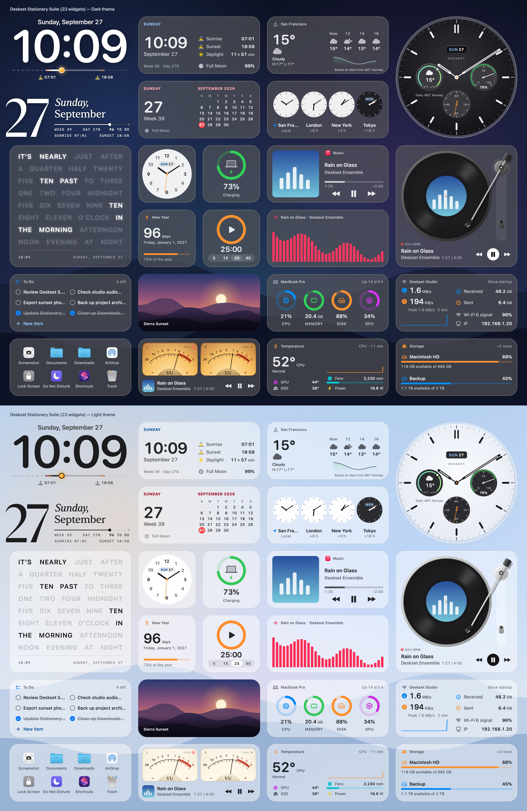

# Deskset

**原生的 macOS 桌面小组件，而且能运行 Rainmeter 皮肤。**

[](https://github.com/jokyme/Deskset/actions/workflows/ci.yml)
[](https://github.com/jokyme/Deskset/releases)
[](LICENSE)


[English](README.md) · [更新日志](CHANGELOG.zh-CN.md) · [下载 (Apple 芯片)](https://github.com/jokyme/Deskset/releases/download/v0.6.0/Deskset-0.6.0-arm64.dmg) · [下载 (Intel)](https://github.com/jokyme/Deskset/releases/download/v0.6.0/Deskset-0.6.0-x86_64.dmg)



Deskset 在 Mac 桌面上放置实时更新的小组件：时钟、日历、天气、系统监控、网速和磁盘、音频可视化、正在播放、待办清单、计时器、
启动器……可以用自带的 **Stationery（文房）** 组件套装，在 Skin Studio 里修改皮肤，也可以直接安装为
[Rainmeter](https://www.rainmeter.net) 制作的皮肤——Windows 世界里海量的 `.ini` / `.rmskin` 皮肤——在 Mac 上运行。

## 名字的由来

*Desk set* 指书桌上成套摆放的物件：时钟、日历、笔座、墨水瓶，都是工作时会随手瞥一眼的小东西。Deskset 把这一套搬到了 Mac
的桌面上。

## 功能

- **Stationery 默认小组件套装。** 内置全套精心设计的桌面小组件——时钟、日历、天气、系统监控、音乐控制、黑胶唱片、音频频谱、照片、
  便签、待办、计时器和常用文件夹启动器——提供深浅外观、多种尺寸与中英文界面。
- **运行 Rainmeter 皮肤（含 5.0）。** 双击 `.rmskin` 安装包，或直接用 Deskset 打开 `.zip` 压缩包与皮肤文件夹。支持各类组件
  （含 SVG 矢量图形与可交互文本输入框）、数据源、公式、变量、Bang、鼠标动作、文件拖放、Lua 脚本，以及为 macOS 原生重写的常用插件
  （AudioLevel、接 Music / Spotify 的 NowPlaying、WebParser、WiFiStatus、InputText、FileInfo、FolderInfo……）。
- **原生、轻量。** 原生 macOS 应用，不使用网页视图。每个小组件都是轻量透明的桌面面板，可放在桌面层、普通窗口层或始终置顶，支持点击穿透、
  贴边吸附、淡入淡出和位置记忆。
- **贴合 macOS 的外观与硬件监控。** 小组件支持 macOS 26 的 Liquid Glass 液态玻璃（较早系统为磨砂模糊）、SF Symbols 系统图标、苹果系统字体，
  以及随系统深浅色模式自动切换的配色；支持直接显示 Mac 的温度、风扇转速、功耗与处理器频率（自动兼容 Windows 的 CoreTemp、SpeedFan
  和 MSI Afterburner 皮肤）。
- **天气与日出日落。** 内置实时、逐小时与多日天气预报（数据来自 [MET Norway](https://api.met.no/)），以及完全离线计算的日出、日落和月相。
  支持离线搜索全球城市、使用 Mac 所在时区城市，或跟随当前位置。
- **Skin Studio。** 代码编辑器与实时预览画布并排显示，支持语法高亮、诊断提示与边改边看，也可一键调用外部代码编辑器打开。

## 系统要求

- macOS 13 Ventura 或更新版本。
- Apple 芯片或 Intel 芯片，各有单独的安装包。
- 部分皮肤需要权限：音频可视化需要“系统音频录制”（macOS 14.2+；13–14.1 为“屏幕录制”），正在播放类皮肤需要控制 Music 或
  Spotify，Wi-Fi 皮肤需要定位服务才能读取网络名称，使用当前位置的天气皮肤也需要定位服务。只有载入的皮肤用到时，macOS 才会询问。

## 安装

1. 直接下载最新版本（或在 [Releases](../../releases) 页面查看所有版本）：
   - [**Deskset-0.6.0-arm64.dmg**](https://github.com/jokyme/Deskset/releases/download/v0.6.0/Deskset-0.6.0-arm64.dmg)（[`.zip`](https://github.com/jokyme/Deskset/releases/download/v0.6.0/Deskset-0.6.0-arm64.zip)）：Apple 芯片（M1 及以后）的 Mac；
   - [**Deskset-0.6.0-x86_64.dmg**](https://github.com/jokyme/Deskset/releases/download/v0.6.0/Deskset-0.6.0-x86_64.dmg)（[`.zip`](https://github.com/jokyme/Deskset/releases/download/v0.6.0/Deskset-0.6.0-x86_64.zip)）：Intel 芯片的 Mac。
2. 打开磁盘映像，把 **Deskset** 拖进「应用程序」，再从「应用程序」打开。也可以打开磁盘映像中的 Deskset，点击
   **Install to Applications**。首次安装时若 `/Applications` 不可写，会使用 `~/Applications`。
   如果没有出现安装提示，请按上述拖拽方式安装。

Deskset 常驻菜单栏，没有 Dock 图标。如果菜单栏图标被隐藏了（macOS 允许隐藏菜单栏项目），从「应用程序」里再次打开 Deskset，
会弹出「Manage Skins」窗口。

### 检查更新与升级

在 Deskset 菜单或 **Settings… ▸ General** 中点击 **Check for Updates…**。默认每天自动检查一次公开发布的新版，
可以在 General 设置中关闭自动检查，改为手动检查。离线或无法连接 GitHub 时，自动检查不会弹出错误提示。
**Close** 关闭本次提示；**Skip This Version** 停止该版本的自动提醒，手动检查仍可看到被跳过的版本。

点击 **Update** 后，Deskset 会在应用内下载并校验适合你的 Mac 的更新。完成后点击 **Install and Relaunch**，
保存编辑、退出应用、替换并重新打开；也可以点击 **Later** 继续使用当前版本。在未保存编辑的提示中取消退出，会暂停安装。
下载失败时可重试，或点击 **Download Manually…** 打开 GitHub 版本页面。应用本身及其所在文件夹需要可写。
更新按 Mac 的实际芯片选择：Apple 芯片下载 `arm64`（即使 Deskset 通过 Rosetta 运行），Intel 下载 `x86_64`。

手动升级时，先在 Deskset 菜单中选择 **Quit Deskset** 并保存编辑，再打开新版磁盘映像。把 Deskset 拖进「应用程序」并选择
**替换**，或打开磁盘映像中的 Deskset，点击 **Replace and Open**。安装器会显示已安装的版本，要求先退出正在运行的副本，
并防止用旧版覆盖新版。如果原应用不可写，请使用 Finder 替换。安装后从「应用程序」打开 Deskset，再推出磁盘映像。
`~/Library/Application Support/Deskset` 中的皮肤与设置会保留。

## 使用皮肤

- **安装：** 双击 `.rmskin` 文件，或用菜单里的 **Install Skin…**。普通 `.zip` 压缩包和皮肤文件夹也可以用 Deskset 打开（打开方式）。
- **管理：** **Manage Skins…**（⇧⌘,）列出所有皮肤，可以载入、卸载，调整位置、层级和透明度。
- **编辑：** 右键皮肤 → **Edit Skin…**，在 Skin Studio 里打开。想用自己的代码编辑器，在 **Settings… ▸ Editor** 里选择，
  右键菜单会多出 **Edit in** 该 App。皮肤文件放在 `~/Library/Application Support/Deskset/Skins`（菜单里的 **Open Skins Folder**）。
- **兼容性：** 右键皮肤 → **Compatibility Notes** 列出与 Windows 不同的地方。完整说明见[兼容性文档](docs/COMPATIBILITY.zh-CN.md)。

皮肤本质上是程序：可以运行 Lua 脚本、抓取网页、执行命令。只安装来源可信的皮肤（见 [SECURITY.md](SECURITY.md)）。

## 天气

天气预报**基于 MET Norway（挪威气象研究所）的数据**，采用 [CC BY 4.0](https://creativecommons.org/licenses/by/4.0/) 许可；
城市名来自 [GeoNames](https://www.geonames.org/)（CC BY 4.0），在本机离线查找。每个天气小组件的右键菜单都会注明 MET Norway
并显示数据的更新时间。

- **隐私：** 只有在桌面上运行的天气小组件才会发出请求。MET Norway 只会收到你的 IP 地址和取整到约 1 公里的地点坐标。
  使用当前位置时会请求一次定位服务，位置取整后只保存在内存中，从不写入磁盘或日志；使用 Mac 所在时区城市则不请求任何权限。
  日出日落和月相计算完全离线，从不联网。
- **关闭联网天气：** `defaults write app.deskset.Deskset WeatherEnabled -bool NO`（恢复：`defaults delete app.deskset.Deskset WeatherEnabled`）。
- 皮肤编写选项与细节见 [docs/compat/weather.md](docs/compat/weather.md)（英文）。

## 已知限制

- 只有 Windows 版的插件（DLL）和皮肤要启动的 Windows 程序无法在 Mac 上运行。皮肤照样能载入，Compatibility Notes 会列出缺了什么。
- 硬件传感器（温度、风扇、功耗、频率）无需特殊权限即可读取，但苹果没有公开文档：可显示的读数因 Mac 型号而异，且为近似值。
- Windows 字体会换成相近的 Mac 字体，文字宽度可能略有差别。

## 常见问题

- **皮肤显示 0 或没有数据：** 先看它的 Compatibility Notes。音频、正在播放、Wi-Fi 类皮肤需要权限；如果之前拒绝了，到「系统设置 → 隐私与安全性」里允许 Deskset。
- **菜单栏图标不见了：** 从「应用程序」里再次打开 Deskset，会弹出 Manage Skins 窗口。
- **其他问题：** 日志在 `~/Library/Logs/Deskset/Deskset.log`，提 issue 时请附上相关的几行。

## 卸载

退出 Deskset（菜单栏 → **Quit Deskset**），把 `Deskset.app` 移到废纸篓。如果要连皮肤和设置一起删除，再删掉
`~/Library/Application Support/Deskset`、`~/Library/Caches/Deskset`、`~/Library/Logs/Deskset`，并执行
`defaults delete app.deskset.Deskset`。

## 从源码构建

需要 Xcode 26（Swift 6.2）或更新版本：

```bash
bash scripts/build-app.sh
open build/Deskset.app
```

开发调试、自测与项目结构说明见 [CONTRIBUTING.md](CONTRIBUTING.md)。

添加 `--package` 可生成 ZIP 和带拖拽安装界面的 DMG。打包还需要 Python 3.10 或更新版本；首次运行会将
`scripts/dmg/requirements.txt` 中固定版本的工具下载到 `build/dmg-tools`，后续复用。Finder 布局与 Retina 背景
无需桌面会话即可生成。

## 参与贡献

欢迎贡献，请先阅读 [CONTRIBUTING.md](CONTRIBUTING.md)，尤其是其中的 clean-room 规则。
想改进 Deskset 在你的语言里的翻译，可以直接在 [Weblate](https://hosted.weblate.org/projects/deskset/) 上修改，不需要会用 Git。

## 许可证

Copyright © 2026 jokyme.

Deskset 是自由软件，采用 [GNU 通用公共许可证 v3](LICENSE)。`DefaultSkins` 里的示例皮肤采用 MIT 许可，可以在它们的基础上制作
自己的皮肤。第三方代码见 [THIRD_PARTY_NOTICES.md](THIRD_PARTY_NOTICES.md)。

Deskset 是独立项目，与 Rainmeter 没有关联，也未获其认可。“Rainmeter”是其所有者的商标，这里仅用于说明兼容性。Deskset
不包含任何 Rainmeter 代码，是依据 Rainmeter 公开文档独立实现的（clean-room）。
